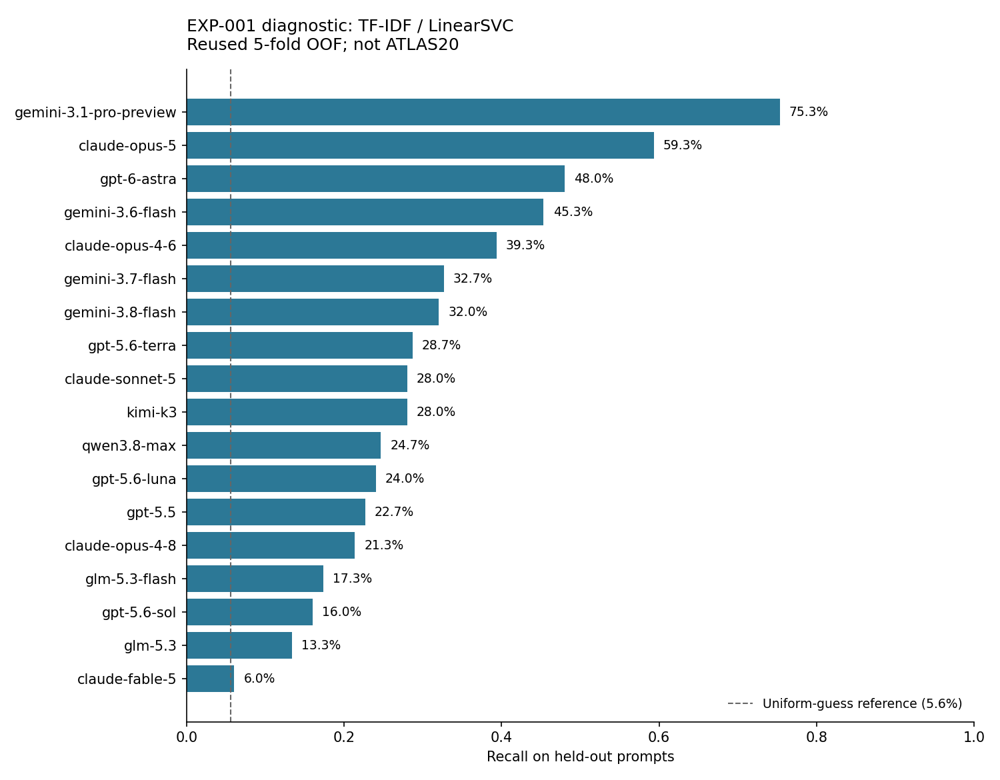

# EXP-007：数据与固定验证基础

本轮完成于 2026-10-31T16:46:29.140909+00:00。沿用 EXP-001 V4 的历史 OOF 并独立复算；**没有重训分类器、重跑 ATLAS20、启用 GPU、调用付费 API 或提交比赛**。0.662 正式基线保持为 EXP-004。

## 已完成与关键结果

- 官方训练数据：2699 条，150 个 prompt、18 类。149 个 prompt 各 18 条；p002 缺 `claude-fable-5`，因此该类 149 条，其余每类 150 条。
- 空值、重复 ID、重复 `(prompt_id, model)`、原文完全重复、NFKC/大小写/空白规范化重复：均为 0。训练与公开测试样例的规范化文本交集为 0。
- 近似重复筛查：比较 3,640,951 对文本，阈值 0.9，得到 0 对候选，其中跨 prompt 0 对、跨折 0 对。候选表保存完整原文，未自动删除。字符词表上限 100,000；这项检查不能发现所有语义改写或证明模型训练数据无泄漏。
- 数据哈希与历史运行完全一致；2699 行样本 ID、标签、决策分数、预测、正确标记和五折位置一一对应；各折指标也与原记录一致。
- 轻量模型 OOF Balanced Accuracy **0.312245**；正确 843/2699。这是重算历史结果，**不是一次新提升，也不是 ATLAS20 的验证成绩**。
- 固定产物：[划分清单](../../validation/prompt-group-v1/manifest.json)、[逐行折表](../../validation/prompt-group-v1/folds.csv)、[使用规则](../../validation/README.md)、[数据来源清单](../../data/source-inventory.json)。

## 轻量模型暴露的困难

以下只支持 TF-IDF/LinearSVC 的诊断，不能据此认定强集成也存在同样弱项。

召回率最低的六类：

| model | support | correct | recall |
|---|---|---|---|
| claude-fable-5 | 149 | 9 | 6.0% |
| glm-5.3 | 150 | 20 | 13.3% |
| gpt-5.6-sol | 150 | 24 | 16.0% |
| glm-5.3-flash | 150 | 26 | 17.3% |
| claude-opus-4-8 | 150 | 32 | 21.3% |
| gpt-5.5 | 150 | 34 | 22.7% |

最常见的有方向误判：

| true_model | predicted_model | count | fraction_of_true_class |
|---|---|---|---|
| gemini-3.8-flash | gemini-3.7-flash | 47 | 31.3% |
| gemini-3.7-flash | gemini-3.8-flash | 43 | 28.7% |
| gpt-5.6-sol | gpt-5.6-luna | 33 | 22.0% |
| gemini-3.7-flash | gemini-3.6-flash | 32 | 21.3% |
| glm-5.3 | claude-opus-5 | 32 | 21.3% |
| gpt-5.6-luna | gpt-6-astra | 31 | 20.7% |
| claude-fable-5 | claude-opus-5 | 27 | 18.1% |
| gpt-5.6-terra | gpt-6-astra | 27 | 18.0% |

全部错例中，同一厂商/家族前缀之间的混淆占 49.0%。Top-2 命中率为 47.6%；它只是排名诊断，不是提交指标。分差较大的前 50 个错例见 [error_examples.csv](outputs/error_examples.csv)，分差不是校准置信度。

按空白分词的长度切片如下。切片间类别、题目难度可能不同，不能当作“长度导致正确率变化”的因果证据。

| length_bin | rows | classes_present | accuracy | macro_recall_present_classes |
|---|---|---|---|---|
| <=80 | 1019 | 18 | 0.2493 | 0.2513 |
| 81-140 | 844 | 18 | 0.327 | 0.3267 |
| 141-200 | 532 | 18 | 0.3571 | 0.3505 |
| >200 | 304 | 18 | 0.4046 | 0.3828 |

更多产物：[混淆矩阵图](outputs/confusion_matrix.png)、[逐行诊断](outputs/oof_diagnostics.csv)、[按 prompt 的难度](outputs/prompt_difficulty.csv)、[近似重复候选](outputs/near_duplicate_candidates.csv)。官方文件没有 prompt 原文，本轮没有推断或编造题材标签。

## 外部数据：已登记，尚未清洗

已登记 Drive 输入清单中的全部 31 个资产引用，单独列出 6 个明确的生成文本来源：

| 来源 | 固定版本 | 审计 |
|---|---|---|
| seyitkaangunes/ntl-extra-api-passages | 2 | 来源登记；未读原文 |
| abdullah1afify/ntl-generations | 2 | 来源登记；未读原文 |
| dophuchung/ntl-proxy-generations | 1 | 来源登记；未读原文 |
| dhruvtibarewal/nlm-matched-clean | 3 | 来源登记；未读原文 |
| lucasboesen/ntl-free-proxy-generations | 7 | 来源登记；未读原文 |
| prvsiyan/prvsiyans-extended-name-that-llm-dataset | 6 | 来源登记；未读原文 |

版本来自已有本地缓存清单，本轮没有重新连接云端核查，也没有读取这些公共池的全部原文；其他模型资产也可能包含训练表，后续需继续检查。部分文件的历史期望哈希已随来源登记，但本轮尚未对实际内容核验；外部样本数、准确生成模型版本与去重结果仍为未知，不能声称已建立干净的大训练池。

## 后续实验沿用的约束

1. 五折严格按 prompt 分组；拟合 TF-IDF、分类器和监督统计量只用训练折。现成 LoRA 的训练范围要另外核查，不能用这套折表把全量训练适配器的输出变成干净 OOF。
2. 这一套折已经用于开发，不是未触碰的最终 holdout。限制调参候选；需要更强效果证据时再做嵌套验证或新增独立 prompt。
3. 稀疏回答压力测试预设每 prompt 2/3/6 条、5 次固定抽样；本轮只提供选样函数，没有跑稀疏推理。组相关后处理要先选文本、再重新计算，不能抽取完整组预测。
4. 原文保持大小写、标点和排版；规范化只用于审计。外部数据必须核对生成模型的准确版本，并排查跨来源重复、验证 prompt 和来源特征与标签的混淆。

**推荐下一步：固定这套折与现有轻量分类器，审计并小规模比较公共池的原始版、清洗版、等量抽样版。先检验数据是否有用，再把有希望的数据配方交给强模型确认。** 每轮另登记 EXP，不用这次诊断替代强集成的逐成员错误分析。

## 复核

本轮只下载 EXP-001 的固定 V4 源码和产物。来源：[历史 Notebook V4](https://www.kaggle.com/code/zhjianduan/name-that-llm-no-llama-groupcv?scriptVersionId=363168447)。完整来源哈希和源码检查记录见 [reference-integrity.json](outputs/reference-integrity.json)。原 parquet 保留；本地以其 CSV 转换件读取，18 列分数来自原始 NPY。

`python -X utf8 experiments/EXP-007-validation-foundation/analyze.py` 可重算报告；已有固定划分如发生变化会拒绝覆盖。`python -X utf8 -m unittest discover -s validation -p test_protocol.py` 检查泄漏和缓存错位保护。运行环境与实际审计耗时见 [metrics.json](outputs/metrics.json)。

方法参考：[sklearn 数据泄漏与 Pipeline](https://scikit-learn.org/stable/common_pitfalls.html)、[按组交叉验证](https://scikit-learn.org/stable/modules/cross_validation.html#cross-validation-iterators-for-grouped-data)、[Balanced Accuracy 定义](https://scikit-learn.org/stable/modules/generated/sklearn.metrics.balanced_accuracy_score.html)。
