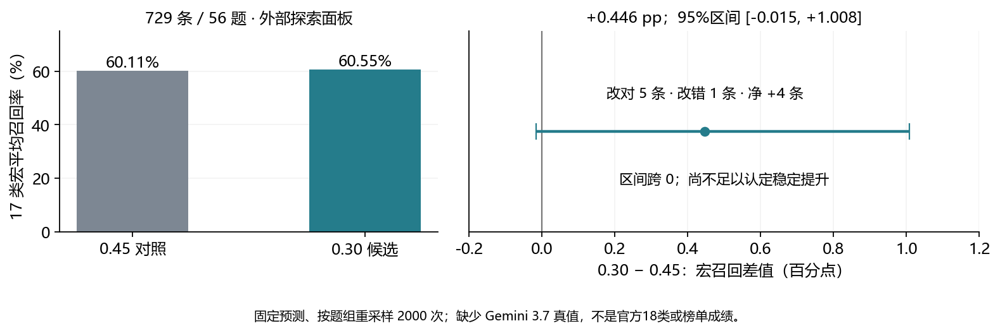

# EXP-032 固定缓存比较 Sinkhorn 0.45 与 0.30

**真实比较已完成：0.30 在本面板净多答对4条，但差值区间跨0，保留为候选，不替换正式0.662基线。**

这是729条、56个题组、17个真实类别的外部探索面板；预测始终保留18类。它不是官方18类验证分数、干净OOF或Kaggle榜单成绩。面板已在EXP027查看，完整集成成员的训练隔离未得到证明。

## 实际结果

| 指标 | 对照0.45 | 候选0.30 | 差值 |
|---|---:|---:|---:|
| 17类宏平均召回率 | 0.601075 | 0.605540 | +0.4465个百分点 |
| 样本准确率 | 0.669410 | 0.674897 | +0.5487个百分点 |
| 答对条数 / 729 | 488 | 492 | +4 |

0.30修正5条、引入1条新错；共9条预测变化，涉及8题。按56个原题整组配对bootstrap，2000次、seed42，宏召回差值95%区间为 **[-0.0151, +1.0076]个百分点**，2000次均包含17类。区间条件于现有模型与面板，不包含重新训练的不确定性；跨0不等于两者等价。

## 哪些类别发生变化

- Gemini3.1多对1条；Gemini3.6多对2条；GPT5.5、Sol各多对1条。
- Terra少对1条（原本判对，改成Astra）；其他真实类别答对数不变。
- 本面板预先排除了未核实服务身份的Gemini3.7，因此没有该类真值，但始终保留其预测列。0.45判为3.7的22条降至0.30的19条，其中两条改判3.6后正确、另一条仍错。这个缺类、非均衡面板可能影响平衡强度结论，不能删除这一列或利用真值类别占比来调参数。
- 在这份小面板上Kimi为0/17、GLM5.3为2/16，需检查来源身份、任务差异和混淆方向；样本量很小，不能外推为官方测试集的类别表现。

## 验收与复现

真实来源为EXP031固定V2，run_id `exp031-20261101T110842Z`。原始565个归档成员与外部固定清单逐项核验；输入、源代码、成员、设备、完整ATLAS覆盖及缓存数学重放通过。0.45重建最终分数最大绝对误差1.78e-15、全部argmax与原Parquet一致，然后才计算0.30和读取标签。两臂只改变Sinkhorn强度，两侧分别重算标点置信度门控。

冻结协议、代码与当时config字节保持不变；准备状态属于开跑前快照。实际状态以本报告、[执行结果](analysis-v1/result.json)、[验收清单](analysis-v1/analysis-manifest.json)及台账为准。

- [统计摘要](analysis-v1/summary.json) · [逐类结果](analysis-v1/per_class.csv) · [逐行预测](analysis-v1/predictions.csv) · [错误变化](analysis-v1/errors.csv)
- [原缓存下载收据](../EXP-031-full-stack-capture-r1/metrics/download-receipt.json)
- [独立统计复核](metrics/independent-verification.json)

本地比较复用已下载预测，没有GPU、模型调用、生成数据或正式提交。本轮不增加其他参数扫描，不用已查看面板选择新的系数。

## 新数据与下一步

采集窗口已完成EXP041审计，本窗口再次复核23个绑定文件哈希、378份原文哈希和跨协议题组划分。300条新Codex回答为75题×4模型；240训练/60保留，其中Luna/Terra120、Sol/Astra120。78条双渠道面板为10题的诊断材料，继续单独保存。

建议下一项固定对照是轻量分类器不加新增数据/加入Luna与Terra120条，保持同一基线、数据权重规则与验证划分；Sol/Astra另作实验。所有旧新、渠道和重复回答按原题一起分组，60条保留集不训练。新增数据只有GPT家族，不能认为它能直接修复Kimi/GLM问题。Codex身份仍为requested_only、底层snapshot未知，来源标签必须保留。

这一建议尚未启动训练、重新生成或正式入池。详见[EXP041数据审计](../EXP-041-aligned-channel-repeat-audit/report.md)。
