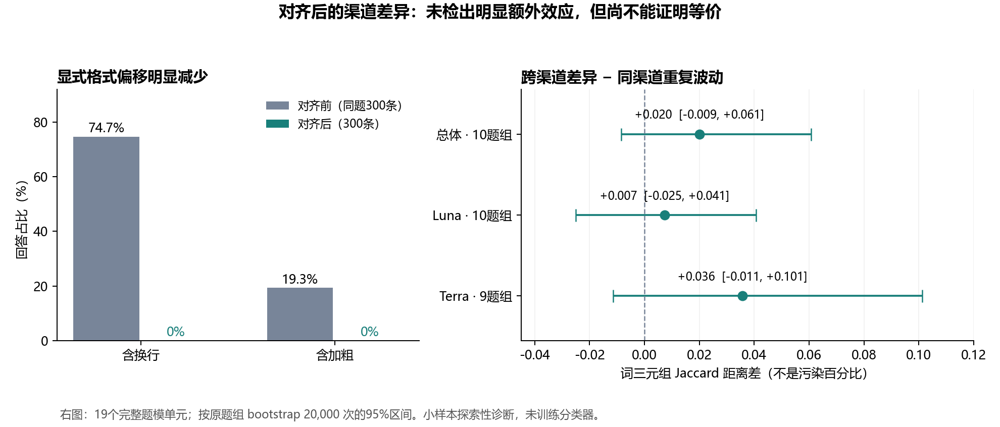

# EXP-041 对齐后双渠道重复对照与训练适用性

**结论：显式格式偏移明显减轻；本小面板未检出跨渠道差异明显超过同渠道重复波动。Luna/Terra可以作为独立来源的受控训练候选，尚不能认证为裸API等价、内置上下文已消除，或已经提高分类器效果。Sol/Astra只有格式/完整性证据，不具备本次两路重复对照证据。**

本次只读取已经采集的原文，进行本地统计、请求和文件核验、人工浏览与独立复算。没有调用生成模型、拟合分类器、修改原文、实际导入训练池或提交比赛。完整计算见 [analysis.json](metrics/analysis.json)，复现脚本见 [analyze.py](code/analyze.py)。

## 配对与统计单位

EXP038保存78条回答：Codex40、Kaggle38，共10个原题、Luna/Terra两模型，每路每题模计划重复两次。19个题目×模型单元完整，形成76条用于主配对分析的回答。`cp0123/Terra`的两次Kaggle历史结果未知，未作零值、空回答或插补；对应Codex两条仍保留在78条原始概况中。

每个完整单元先算两条同渠道距离（Codex1对2、Kaggle1对2）和四条跨渠道距离（2×2），再比较其均值。模型单元先在同原题内等权平均，再把10个原题等权平均。不能把76条回答、76次交叉比较或19个题模单元当作独立题目。区间用整个原题组的percentile bootstrap，20,000次，seed=2026110141；这是小样本探索性区间，没有预设等价界限。

## 跨渠道差异与正常重复波动

| 指标 | 同渠道重复 | 跨渠道 | 跨渠道减同渠道 | 差值95%题组bootstrap区间 |
|---|---:|---:|---:|---|
| 词三元组Jaccard距离 | 0.8250 | 0.8451 | +0.0200 | [-0.0085, +0.0607] |
| 字符三元组余弦距离 | 0.1805 | 0.1842 | +0.0037 | [-0.0023, +0.0101] |
| 回答绝对词数差 | 4.475词 | 4.625词 | +0.150词 | [-0.700, +1.100] |

距离越大表示表面用词越不同。0.845不是“84.5%内容不同”，+0.020也不是“污染2%”；这两种词汇指标不衡量事实正确率或模型可识别性。跨渠道表面差异与正常重生成差异相近，是支持使用候选数据的证据；区间跨零不能证明无效应或等价。

按模型的词三元组超额差异为Luna +0.0073，95%区间[-0.0250,+0.0406]；Terra +0.0357，区间[-0.0114,+0.1013]，Terra不确定性更大。只使用两模型均完整的9个题组时，总体差值+0.0215，区间[-0.0105,+0.0670]，结论没有改变。

Codex相对Kaggle的平均词数差为-2.075词，整体区间[-4.025,0]；9个完整双模型题组的敏感性分析为-2.806词，区间[-4.472,-1.222]。因此不能声称所有可测风格都没有渠道差异。句末标点、分号、冒号、逗号差异也记录在JSON中，属多指标探索，不作为未经校正的独立验收门槛。

一个值得继续观察的单元是`cp0144/Terra`：同渠道词距离0.4466，跨渠道0.7103，差值+0.2637。Kaggle两次措辞很接近，Codex有更多改写，但四条都保留“收到申请不等于房间预订批准”的核心含义。它说明个别题有残余措辞差异，不能从总体均值推出每题等价，也不能据此归因为系统提示词。

## 对齐后什么改善了

对照同一75原题×4模型的旧300条和新300条，base_prompt与split逐条吻合。

| 可观测特征 | 旧300条 | 新300条 |
|---|---:|---:|
| 含换行 | 224（74.67%） | 0 |
| 含加粗 | 58（19.33%） | 0 |
| 新协议任一格式规则命中 | 228（76.00%） | 0 |
| 词数偏离目标超过25% | 8 | 1 |
| 平均词数 | 133.12 | 134.56 |

旧回答当时没有这些格式要求，表中的旧命中不是“违反当时指令”。新300条加上双渠道78条，378/378通过同一冻结格式筛查。规则通过不等于所有语义上的格式或任务质量均被认证。

旧10题×2模型面板的两路换行都是13/20，旧加粗为Codex6/20、Kaggle1/20；新面板两路换行/加粗均为0。这更符合“补齐共同显式要求后消除了一个重要混杂”的解释，不能量化内置提示词的因果作用。

**没有证据表明对齐让两路整体措辞更相似。** 在同一19完整单元、同一题组权重下，旧跨渠道词距离0.8332，新为0.8451；新减旧+0.0119，区间[-0.0165,+0.0528]。旧每路只有一次生成，没有旧同渠道波动基线，不能声称跨渠道超额差异在对齐后显著下降。

官方同四标签600条本次重读：换行和加粗均0，em dash占23.83%。新300条em dash为6.33%，旧匹配300条为40.33%；均值词数官方116.34、新300为134.56。格式现在更接近，但整体风格与长度仍非同分布证明。官方题目/原始请求未知，公共数据存在格式约束、筛选、后处理与来源重叠，这些分布差异不能直接归因于Codex。

## 直接污染、完整性与剩余配置差异

378条新回答原文及哈希全部核验通过，新样本之间和与旧1000条没有归一化精确重复。与EXP033固定四模型官方/公共行特征索引的归一化哈希比较也为0重合；该索引覆盖范围和来源计数见 [frozen-reference-overlap.json](metrics/frozen-reference-overlap.json)，不是全标签、全版本或语义去重。

378条强污染规则（Codex/AGENTS/技能/记忆/角色标记/工具命名空间/工作区路径等）均未命中。唯一弱规则“Of course”位于Terra/cp0172请求的邮件正文中，不是额外助理评论。人工浏览78条配对回答未见身份自述、拒答、指令泄露或正文外助理包装；邮件的称呼和落款按任务内容保留。旧1000条此前也没有明确直接泄露，故不能把新0命中说成直接污染率从有到无。

唯一长度异常为Terra/cp0150：目标160词、实际90词。正文完整总结照片、日期核验和打印交付，结束事件正常，不能把长度不足当截断；保留原文与标记，不因结果偏短自动删除或补采。人工浏览中cp0102/Luna/Codex重复2有不自然创作细节，属于真实模型输出的局部质量问题，不是指令污染证据，也不应按“写得不够好”事后筛掉模型风格。

实际请求的user文本字节、最小基础指令文字和low一致。仍有边界：Codex340条模型身份均为requested_only；Kaggle38条只确认返回别名，全部底层snapshot未知；temperature/top_p/seed未显式设置，实际默认未知；Kaggle上限1024，Codex无对应显式上限。用量回执输入token中位数仍为Codex Luna2679/Terra4214、Kaggle136/137。计数口径不能解码隐藏指令，也不能量化其效果；不能据此认证完整请求相同。

本次已通过OpenAI Docs MCP检索并读取[配置参考](https://learn.chatgpt.com/docs/config-file/config-reference)：`model_instructions_file`是内置指令替换项，`developer_instructions`是附加指令项。文档与本地命令证据均未提供这378次请求完整服务端上下文，故不作“清除了所有内置提示”的结论。

## 训练适用性决定

**保留并允许开展受控训练验证；未通过正式训练池或训练收益验收。**

| 新300条的分组 | 条数 | 本次判断 |
|---|---:|---|
| Luna/Terra训练组 | 120 | 有同渠道重复参照，作为带来源/协议标签的辅助训练候选 |
| Sol/Astra训练组 | 120 | 格式与完整性通过，可作独立探索实验臂；缺少这两个模型的渠道配对证据 |
| 原holdout组 | 60 | 保留验证用途，不入训练 |

这是派生用途清单，**没有实际移动、清洗、丢弃或导入任何回答**。[逐条用途判断](metrics/training-eligibility.jsonl)保留全部300条、模型/原题组/原文路径和长度标记；正式入池字段均为false。78条双渠道面板继续作为诊断材料，不因本分析自动并入训练。

后续最小有效验收是固定现有基线及官方/公共原题组验证，先比较“不加Codex”和“加入Luna/Terra候选”，Sol/Astra另作实验臂。只有外部或官方分组验证支持改善且没有关键类别退化，再决定入正式池和权重。此次没有训练，不能给出已经提升的分数或所谓最佳混合比例。仅给4类追加某一来源也会形成来源与标签相关，需在训练验证中检查，不能用表面相似度代替。

原题组是硬边界：旧1000、新300、两渠道、所有重复和模型变体，凡同一个base prompt都必须在同一split。尤其不能旧版同题进入训练、新版同题放holdout。新300不是300个独立问题，仍是原题库75题；原240train/60holdout保持不变。本次面板10题均来自train，亦不能当最终泛化验证集。

## 可复现证据

- [输入哈希及读取后复核](metrics/input-hashes.json)、[逐行筛查](metrics/row-screen.json)、[主统计及逐单元结果](metrics/analysis.json)。
- [请求与人工浏览证据](metrics/provenance-review.md)、[旧新及官方对照](metrics/historical-review.md)。
- [独立统计复算](metrics/independent-verification.md)：独立实现两类距离与字数差，10题组主分析和9题组敏感性均一致，浮点最大差异约1.1e-16。
- `python -B -X utf8 experiments/EXP-041-aligned-channel-repeat-audit/code/analyze.py`
- `python -B -X utf8 experiments/EXP-041-aligned-channel-repeat-audit/code/finish_analysis.py`

上述命令只读原始数据并更新本EXP派生分析；第二条生成用途清单、固定索引查重和报告图。图形已检查文字、坐标、零基线、区间和图注。所有采集器、原文和既有训练资产未改动。
