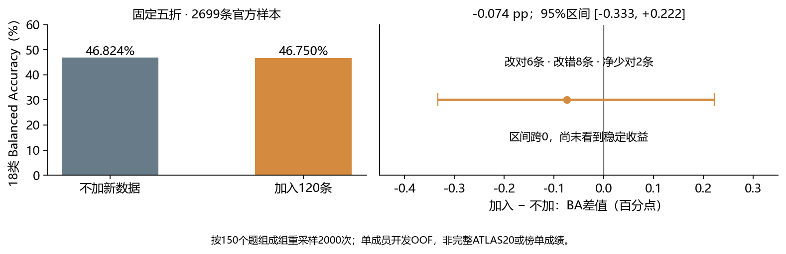

# EXP-042：Luna/Terra 120条增量实验结果

**验收完成：加入120条后，没有看到总体稳定提升，保留原基线。**

运行于北京时间2026-11-01 23:21:37结束，CPU墙钟2896.151秒（约48分16秒），20个SVM、两臂五折及150份稀疏缓存均完成。211个稳定产物哈希、实际固定依赖环境及独立统计复算通过；对照组与EXP010的完整OOF、五折及75份对照稀疏缓存数值完全一致。

## 核心结果

| 指标 | 不加120条 | 加入120条 | 差值 |
|---|---:|---:|---:|
| 18类OOF Balanced Accuracy | 0.468243 | 0.467502 | -0.0741个百分点 |
| 普通准确率 | 0.468322 | 0.467581 | -0.0741个百分点 |
| 答对条数 / 2699 | 1264 | 1262 | -2 |

29条预测改变，其中修正6错、新增8错，其余15条仍错。按150个官方prompt配对bootstrap，2000次、seed42，95%差值区间为 **[-0.3333, +0.2222]个百分点**，没有缺类抽样。五折净正确数依次-1、0、0、-3、+2。这不支持稳定提升，也不足以认定稳定退化；不能把“不显著”解释为等价。

## Luna/Terra 的收益与代价

| 类别 | 正确识别 | 召回率 | 其他模型被错报为该类 |
|---|---|---|---|
| Luna | 69→71 | 46.00%→47.33% | 82→90 |
| Terra | 50→52 | 33.33%→34.67% | 70→75 |

两类召回各升1.33个百分点，但precision分别从45.70%降至44.10%、41.67%降至40.94%。候选更倾向输出这两个标签，更多误报抵消了召回收益；其余16类合计净少对6条。该诊断不能证明系统提示污染或某个单一机制，因为本轮同时包含新增文本带来的词表/IDF变化和既定的两类总权重增加。

## 稀疏压力测试

以下均为原固定抽样方案，每个repeat先拼接五折再计算18类BA，最后对五个repeat求平均。

| 场景 | 不加：平均BA | 加入：平均BA | 平均差值（百分点） | 升 / 降次数 |
|---|---:|---:|---:|---|
| 每题2条 | 0.359868 | 0.363743 | +0.3875 | 3 / 2 |
| 每题3条 | 0.392327 | 0.394367 | +0.2040 | 3 / 2 |
| 每题6条 | 0.434269 | 0.434963 | +0.0693 | 3 / 2 |

次要场景有小幅正向均值，但各档都是3升2降；这5次抽样共享同一批官方题组和已拟合模型，不是5次独立训练。它们不能后验替代预先固定的完整OOF主终点。

## 决策与限制

保留原Stylegram和完整ATLAS20正式0.662基线，这120条暂不并入正式训练池，也不据此扩大采集。数据和全部预测保留；本轮只说明这套数据、权重及分类器配方未证明总体收益，不能断言Codex数据普遍无效、有害或渠道污染已被证实。

后续“是否仅因120条太少、旧1000条能否复用”的只读分析见[数据量与旧数据分析](data-volume-analysis.md)：旧1000只有800条训练数据，其中LT400；与新120存在同题重合和协议格式差异。新的计数不是学习曲线或新增训练结果。

未读取新60条holdout用于训练或评分，未评分有近似题重叠的EXP027。官方五折是已经查看过的开发验证；单成员BA不等于整栈榜单分数。Bootstrap条件于这些已拟合模型，不包括重新训练的不确定性。没有重跑、继续调参、GPU、API生成或正式提交。

[统计摘要](analysis-v1/summary.json) · [逐类结果](analysis-v1/dense_perclass.csv) · [逐行预测](analysis-v1/predictions.csv) · [完整验收](analysis-v1/verification.json) · [独立复算](metrics/independent-result-check.json) · [下载收据](metrics/download-receipt.json)。

## 冻结设计记录

## 假设与主要改动

复用EXP010的Stylegram配方，两臂在相同固定CPU环境重新训练。每个官方验证折各训练plain与centred两个SVM，五折共20个SVM。

| 项目 | control | add120 |
|---|---|---|
| 官方训练 | 原五折的训练部分 | 相同 |
| 原公共输入 | 固定10073条/694组 | 相同 |
| 新训练输入 | 无 | Luna60＋Terra60，60题 |
| 原行权重 | 原配方：官方每行0.5，公共按类计算 | 与control逐行相同 |
| 新行权重 | 无 | 沿用同类原公共行权重 |
| 四路TF-IDF | 仅本臂当前折训练文本拟合 | 同样仅本臂训练文本拟合，包含新增120 |

C=0.5、float64、dual=True、max_iter=4000、seed=42及原plain/centred路由不变。每臂分别拟合词表，禁止用候选词表影响control。新同题答案用独立codex题组参与训练中心化，不合并进既有公共题组。原文不润色。

旧公共权重分母不随新增120改变。Luna/Terra原公共各694条，因此其总有效训练权重各自然增加30/694≈4.32%；不再归一化，不扫权重。本轮测试这一固定加数据配方，无法单独拆分新增文本与两类总权重小幅增加的作用。

## 运行前核验

清单已冻结，120原文/60题组与旧新split、官方/公共known-exact隔离均通过。[数据审查](metrics/data-review.md)、[本地预检](metrics/preflight/preflight.json)和[独立代码审查](metrics/code-review.json)保留了实际证据；本地预检未训练，依赖差异如实记录，云端正式运行会严格核对版本。

- 官方2699行/150题/18类继续原`prompt-group-v1`五折。
- 主指标为合并五折的18类Balanced Accuracy；附准确率、逐类召回、逐折结果、改对/改错及2000次seed42按prompt配对bootstrap。
- 稀疏m=2/3/6、各5次固定抽样。先选验证文本再重新无标签分组和中心化；拼接五折后计算指标。
- 新60条holdout不训练、不拟合词表、不评分；78条双渠道面板不加入。云端包不包含这些原文，完整审核报告留本地。
- 新数据与EXP027外部面板存在潮汐/版本控制近似题，本轮不评EXP027，也不称其为独立验证。
- 解释候选增益前必须先核对control复现已验收EXP010原0.5预测、所有折和稀疏产物完整；不相符则阻断结论，不自动重跑。

