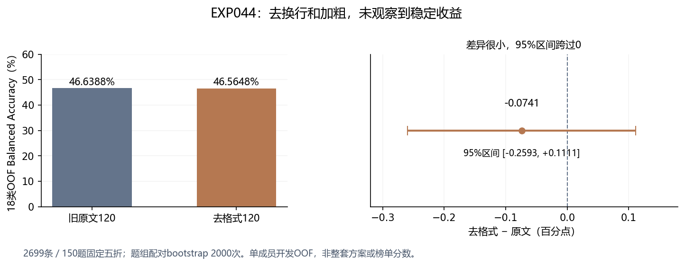

# EXP-044 · 旧120原文与去格式120：两路并行对照

**Kaggle固定第2版COMPLETE，完整产物验收与独立复算通过。去格式未显示稳定收益，暂不作为默认训练处理；并行运行达到预期耗时。**

## 本次比较

两组使用同60题、Luna/Terra各60条旧回答。raw120保留EXP023原文，clean120只应用EXP043已验收的换行/成对加粗移除。86行发生格式变化，34行不变；原文、标签、题组、行顺序、权重保持对应。两组共享官方2699行固定五折、原公共10073行/694组、Stylegram核心与参数；不使用保留集、不加入Sol/Astra、不改正式0.662基线。

## 主结果：18类Stylegram单成员OOF

| 组 | Balanced Accuracy | 普通准确率 | 答对/2699 |
|---|---:|---:|---:|
| 旧原文120 | 0.466388267 | 0.466469063 | 1259 |
| 旧去格式120 | 0.465647527 | 0.465728047 | 1257 |

去格式减原文为 **-0.0741个百分点**。共9条改判，修正2条错、引入4条新错，净少对2条。150题组配对bootstrap2000次、seed42，95%区间 **[-0.2593, +0.1111]个百分点**，跨0；不能认定清洗必然有害，也没有稳定提分依据。

五折净答对变化为-1、0、+1、0、-2。Luna仍为69/150、Terra仍为50/150，两类召回未改变。其他类别净变化是Sonnet+1、GLM5.3+1、Gemini3.6−2、Gemini3.7−2。

## 稀疏压力测试

每题只保留m条回答、每档五次固定抽样，重新做无标签聚类与中心化。

| m | 原文平均BA | 去格式平均BA | 差值（百分点） |
|---|---:|---:|---:|
| 2 | 0.362559 | 0.363239 | +0.0680 |
| 3 | 0.394657 | 0.393432 | -0.1225 |
| 6 | 0.432976 | 0.432581 | -0.0395 |

m2略升，m3/m6略降，方向不一致。15种场景复用相同训练模型，不能当作15次独立实验。

## 运行与完整性

- 私有Notebook `zhjianduan/name-that-llm-format120-044`，固定V2；Kaggle输出版本标识364606984。MCP查询COMPLETE，365个远端文件；下载8498985字节结果ZIP，安全解包348文件。
- 十个fold/arm任务、二十个SVM、十份完整折缓存、150份稀疏折缓存、两份2699×18 OOF均完整；ID、标签、折、权重、路由、哈希、实际环境通过。
- 实际numpy2.1.3/pandas2.3.3/scipy1.16.3/sklearn1.6.1/Python3.13.15；云端串行/并行小样本分数差0。最高两个worker，guard退出0，子进程树已结束，无失败重试。
- 守护计时 **28分13.8秒**，峰值RSS **9.84GiB**。Notebook日志最后事件约28分39秒，平台截图约28分40秒；二者包含范围不同，不能混为纯训练时间。
- 相比EXP042守护48分16秒，本次墙钟约少41.5%。两轮训练数据/两臂不同，只能作为相近规模的运行参考，不能宣称严格同输入的1.71倍加速。
- 正式运行只执行一次，没有使用恢复；已完成job复用、损坏拒绝等续跑机制通过小样本测试，跨Kaggle会话恢复未在本轮实际执行。

## 决策与边界

保留原文和派生数据，暂不把去格式处理作为默认方案，不升级到正式集成。该结果不足以证明120条数量太少，也不能证明Codex数据普遍无效，或两种格式未来等价。若后续研究扩量，需另设固定协议和权重对照；本轮不自动训练400条或再采样。

这是已用于开发的Stylegram单成员OOF，不是完整ATLAS20的外部0.601结果，也不是Kaggle榜单分数。区间条件于当前已拟合模型，不包含重新训练或未观测来源的不确定性。正式EXP004/0.662保持不变。

## 证据

[配置](config.json) · [冻结清单](manifest.json) · [验收JSON](metrics/verified.json) · [独立复算](metrics/independent-result-review.json) · [运行时间](metrics/runtime-comparison.json) · [逐类](metrics/per_class.csv) · [逐折](metrics/per_fold.csv) · [下载收据](../../cloud/format120-044/outputs-v2/download-receipt.json) · [控制状态](../../cloud/format120-044/execution-state.json)。原冻结源码、数据与原始结果保持不变。
