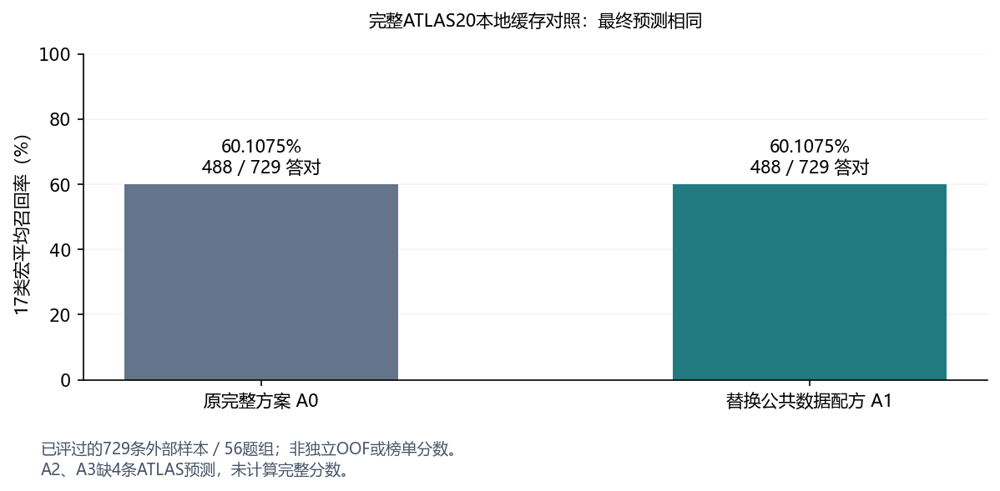

# EXP-045 · 原公共数据候选接入完整ATLAS20：本地缓存四臂验证

状态：**PARTIAL_ATLAS_COVERAGE**。本地忠实完成A0/A1的完整流程评分；A2/A3各缺同样4条ATLAS预测，未计算其完整分数。没有新训练、模型调用、GPU或正式提交。

- 台账原始记录：[EXP-045](../../tracking/records/experiments/EXP-045.json)
- 实验总览：[实验台账](../../tracking/实验台账.md#exp-045)
- 对照为EXP031已验收的完整缓存快照，保持正式EXP004/0.662不变。本轮比较定义先固定再计分；这份面板此前已经评分。
- 参数来源：[config.json](config.json)；文件清单：[manifest.json](manifest.json)。

## 假设与主要改动

将此前公共数据候选放入完整ATLAS20，按原位置替换Stylegram贡献，分开评估配方、标准化和10% svc4融合。原main svc4、其他成员、原训练的五个家族gate分数和主栈除数保持不变。每臂重算家族gate、comp混合、动态ATLAS路由、Sinkhorn0.45/target0.35和标点置信度门控。

| 臂 | 改动 | ATLAS请求/缓存覆盖 | 17类宏召回 | 答对 |
|---|---|---:|---:|---:|
| A0 | 原完整缓存基线 | 206/206 | 0.6010754297 | 488/729 |
| A1 | 仅换当前10073条公共数据的Stylegram配方 | 206/206 | 0.6010754297 | 488/729 |
| A2 | A1的Stylegram margin逐行标准化 | 201/197 | 未计算 | 未计算 |
| A3 | .9×标准化Stylegram + .1×标准化raw svc4 | 202/198 | 未计算 | 未计算 |

A1相对A0最终改判0条、改对0条、改错0条，宏召回差0。两者整体准确率均为0.6694101509，与17类宏召回使用不同分母，不能混称同一指标。

## 运行前核验

729条、56题组、17个真实类别；预测始终使用18列，缺少Gemini3.7真值。EXP027两个轻量原始margin已按source_id→盲化id重排，729个位置全部不同，不能直接按旧行序拼接；正文哈希及类别列一致。没有加入自制120条。

实际EXP031日志记录公共EXTRA为**10469条/716组**；EXP009的10325条是当时六来源文件的投影，不能代替实际运行计数。因此A1是当前完整快照到已隔离公共池10073/694的Stylegram配方替换，不能将全部差异解释成纯删除252条。

A1确实改变了分数：旧新Stylegram概率最大差0.00517812，最终logits最大差0.10548998；最终729条argmax仍全部相同。不是没有替换成功，也不能据此推断任意新数据上都等价。

## 执行与结果

本地验收、缓存重放、后处理和指标计算共7.17秒，不含实现与独立审查。7项纯数学测试通过；A0最终argmax与原submission.parquet逐行一致，后处理数组最大误差3.56e-15。独立审查通过，覆盖限制保留。

按56个prompt配对bootstrap，2000次、seed42，A1-A0的95%区间为[0,0]，有效抽样2000次。这是因为本次固定预测完全相同；没有包含重新训练不确定性，不是未来泛化等效证明。未做多候选选择校正。

分数：[summary.json](outputs/summary.json)；逐行预测：[predictions.csv](outputs/predictions.csv)；基线一致性：[baseline-parity.json](outputs/baseline-parity.json)；输入桥接：[input-review.json](metrics/input-review.json)；独立复核：[independent-review.json](metrics/independent-review.json)。

## 剩余四条ATLAS预测

A2/A3需要相同四条额外文本；四臂请求并集210条，旧缓存覆盖206条。没有填零、使用均匀概率、关闭ATLAS或固定旧mask来凑分。数学模块支持显式固定mask诊断，但本次配置禁止用它评分。

已保存只含id/text的[四条补算清单](outputs/atlas-missing-panel.csv)和[补算计划](outputs/atlas-completion-plan.json)，关联原模型参数与输入清单。后续若授权模型推理，只需用相同ATLAS模型/设置补齐这些缺口并做一致性检查，无需重跑其他大模型；本轮未启动这一云端步骤。

## 结论、限制与下一步

本轮没有观察到A1对完整流程最终预测的改善。A2/A3完整结果未知，不能用轻量成员分数或固定覆盖消融替代。正式0.662基线不更新。

这是已查看外部面板上的探索性分数，不是全栈干净OOF、独立确认或Kaggle榜单成绩；现成checkpoint的完整训练隔离仍未证明。不能将0.601075与公开榜单0.662直接相减。
